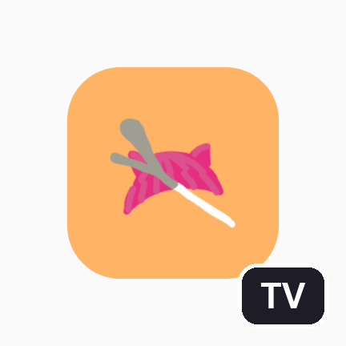
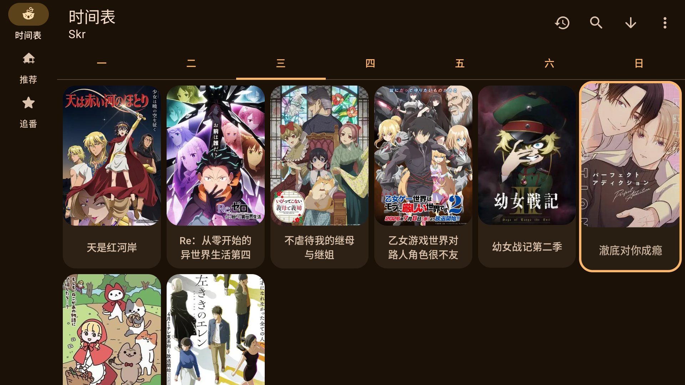
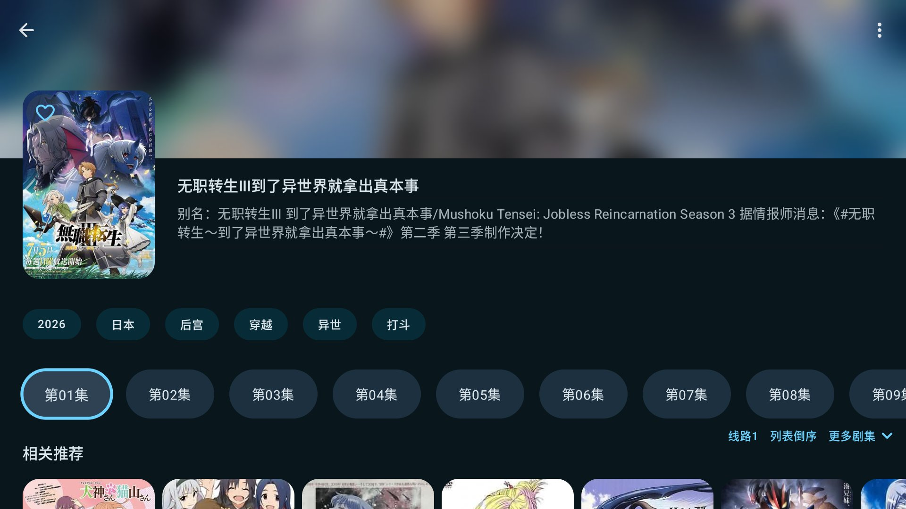

# Animius TV版

**为 Android TV 大屏优化的开源动漫播放器**

遥控器友好 · 弹幕 · 多数据源 · 离线下载

<table>
  <tr>
    <td></td>
    <td></td>
    <td></td>
  </tr>
</table>

## ✨ 功能特性

- 📺 **为遥控器而生**：全局焦点体系，主题色描边让焦点位置一目了然；焦点记忆，离开再回来还在原处
- 🎮 **播放器直控**：播放中双击返回、快进快退带中央气泡提示，不唤起控制栏也能顺手操作
- 💬 **弹幕**：弹幕数据来自 [弹弹play 开放弹幕网络](https://www.dandanplay.com)，集数智能匹配；加载失败时原因可见（网络错误 / 未匹配 / 鉴权问题分类提示），不再一脸懵
- 🗂 **多数据源**：内置多个动漫数据源，一键切换，某个源波动时快速换源
- 🗓 **每周时间表**：按周组织的新番更新表，追番节奏一目了然
- ⭐ **追番收藏 & 历史记录**：收藏追番、断点续播
- ⬇️ **离线下载**：番剧下载，断网也能看
- 🔄 **应用内检查更新**：一键检查并安装新版本
- 🎨 **动态主题**：界面取色自当前番剧封面，随番换色

## 📺 下载安装

1. 前往 [Releases Latest](https://github.com/NEO-CC-OSS/Animius/releases/latest) 下载最新 `.apk`（单包支持全部架构）
2. 通过 U 盘、局域网等方式把 APK 传到电视 / 盒子上安装，也可在电视浏览器中直接下载
3. 首次安装需在系统设置中允许「安装未知来源应用」

- **系统要求**：Android TV / Android 8.0 及以上
- **覆盖升级**：直接安装新版本即可保留数据；若提示签名冲突，说明设备上装过其他来源的旧版本，需先卸载再安装

## ❓ 常见问题

**弹幕不显示？**
弹幕来自弹弹play 开放平台，需要设备能正常联网；部分冷门剧集可能未被弹幕库收录，此时会提示「未匹配」。

**播放加载失败？**
数据来自公共网络，个别线路会有波动。可切换数据源或稍后重试，播放器已内置网络异常自动重试。

**遥控器按了没反应？**
留意屏幕上的焦点框位置；个别系统的「鼠标模式」会干扰焦点操作，可尝试关闭。

**手机能用吗？**
本项目主要面向 TV 大屏优化，手机和平板可以安装使用，但交互体验以电视为准。

## 🔧 自行构建

- 环境：JDK 17 + Android SDK（用 Android Studio 打开工程最省事）
- 构建：`./gradlew :app:assembleDebug`（正式版用 `assembleRelease`）
- 弹幕功能：需在 [弹弹play 开放平台](https://www.dandanplay.com)申请开发者凭证，并在工程根目录的 `local.properties` 中配置 `dandanplayAppId` / `dandanplayAppSecret`（该文件不会入库）
- 本项目仅供学习交流，弹幕功能免费，无任何商业用途

## 🙏 致谢与声明

- 上游项目：[lanlinju/Animius](https://github.com/lanlinju/Animius)（GPL-3.0）。本仓库是经原作者同意独立维护的 TV 定制分支，并沿用「Animius TV版」名称，感谢原作者 [Lanlinju](https://github.com/lanlinju) 的开源工作。上游的应用架构说明与参考来源详见[上游仓库 README](https://github.com/lanlinju/Animius#readme)。
- 弹幕数据：[弹弹play 开放弹幕网络](https://www.dandanplay.com)
- 本项目不存储、不分发任何影视内容，所有数据均来自公共网络；仅供学习交流，请于下载后 24 小时内删除，如认可相关作品请支持正版。
